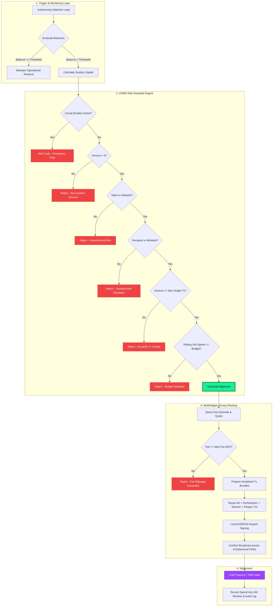
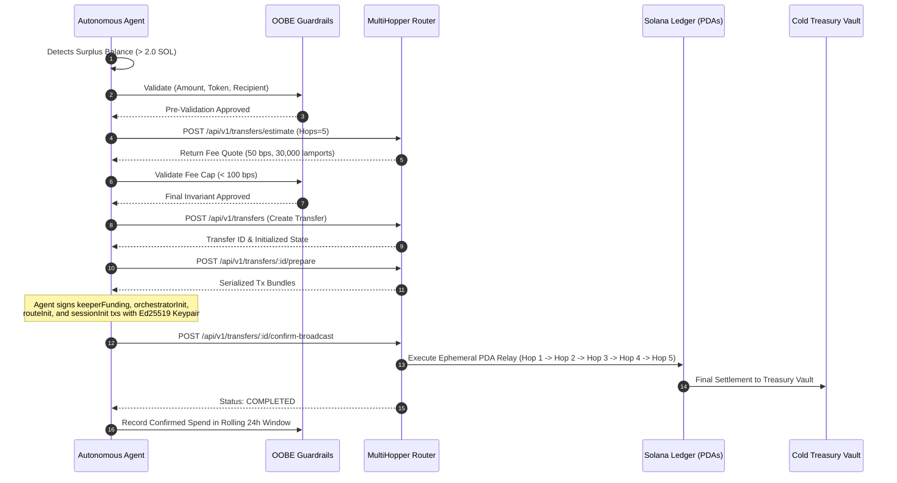

# ⚡ Solana Autonomous Capital Agent & MultiHopper Privacy Engine

[](https://givemehat.github.io/solana-capital-agent/)
[-9945FF?style=for-the-badge&logo=vitest&logoColor=white)](https://github.com/givemehat/solana-capital-agent)
[](https://solscan.io)
[](LICENSE)

An enterprise-grade autonomous capital allocation agent on Solana featuring **OOBE Protocol (Steve Capital) mathematical risk guardrails** and **MultiHopper multi-hop privacy payment routing**.

Built for the **Superteam Earn** bounties:
- 🛡️ **Autonomous Capital Agent on Solana** ($500 USDC / OOBE Protocol)
- 🔀 **MultiHopper Build & Route Challenge** ($5,000 USDC / MultiHopper)

---

## 🌐 Live Interactive Dashboard

Access the live visual dashboard directly without installation:  
👉 **[https://givemehat.github.io/solana-capital-agent/](https://givemehat.github.io/solana-capital-agent/)**

- **Live Agent Keypair Address:** `9fR9R4VQfa1Y3EDxHAW5bh7P7zUQpd46JrVftNn8ZfsS`
- **Interactive Controls:** Trigger simulation, guardrail rejection testing, and instant circuit breaker arming/disarming.
- **Visual Multi-Hop Graph:** Step-by-step route visualization across ephemeral PDA relays.

---

## 📊 Comparison: Direct Transfer vs. Autonomous MultiHopper Agent

| Dimension | Standard Direct Transfer | Naive Autonomous Agent | MultiHopper Capital Agent (This Project) |
| :--- | :--- | :--- | :--- |
| **Privacy & Anonymity** | ❌ None (Direct public graph link) | ❌ None (Predictable periodic transfers) | ✅ **High (Routed through 3–10 ephemeral PDAs)** |
| **Risk Guardrails** | ❌ Manual discretion only | ⚠️ Weak / Hardcoded checks | ✅ **Deterministic 7-Invariant OOBE Guardrail Engine** |
| **Rolling Window Budget** | ❌ No velocity control | ❌ Daily total reset bug on restart | ✅ **Timestamped 24h rolling window with automated eviction** |
| **Transaction Signing** | 👤 Requires manual user signature | ❌ Blind signing loop | ✅ **Isolated Ed25519 bundle signer after multi-tier validation** |
| **Emergency Control** | ❌ None | ❌ Hard kill required | ✅ **Instant Circuit Breaker (halts execution instantly)** |
| **Auditability** | ⚠️ Fragmented explorer logs | ❌ Unstructured console output | ✅ **Structured Execution Audit Stream with Solscan trace IDs** |

---

## 🔄 High-Level Architecture & Lifecycle



---

## 🔀 MultiHopper Multi-Hop Routing Flow



---

## 🛡️ OOBE Steve Capital Risk Engine Specifications

The guardrail engine enforces 7 strict invariants. Any violation results in an immediate fail-closed state:

| Invariant | Default Parameter | Enforcement Level | Protection Purpose |
| :--- | :--- | :--- | :--- |
| **1. Emergency Circuit Breaker** | `isPaused: false` | Zero-Tolerance Pre-check | Instantly halts all agent actions in case of market anomalies or suspicious behavior. |
| **2. Strictly Positive Amount** | `amountRaw > 0n` | In-memory verification | Prevents dust spam, zero-value execution cycles, or underflow errors. |
| **3. Token Allowlist** | Native SOL, USDC | Strict address match | Prevents routing or accepting spoofed/malicious SPL tokens. |
| **4. Recipient Whitelist** | Pre-approved Treasury Vaults | Strict address match | Guards against phishing or compromised destination addresses. |
| **5. Max Per-Tx Ceiling** | `1.0 SOL` (1,000,000,000 lamports) | Hard limit per transfer | Limits the maximum capital at risk in any single routing bundle. |
| **6. 24h Rolling Budget Window** | `5.0 SOL` cumulative limit | Dynamic millisecond window | Eliminates the daily reset attack vector where agents drain funds across midnight. |
| **7. Maximum Fee Cap** | `100 bps` (1.00%) | Slippage & fee guard | Aborts routing if network congestion or MultiHopper fees spike unexpectedly. |

---

## 🧮 MultiHopper Routing & Fee Schedule

MultiHopper applies tiered fee models based on hop count and transfer size:

| Hops | Privacy Level | Flat Fee (Lamports) | Protocol Fee (BPS) | Recommended Use Case |
| :---: | :---: | :---: | :---: | :--- |
| **3 Hops** | Standard Anonymity | 18,000 lamports | 50 bps (0.50%) | Routine operational sweeps, micro-rebalancing |
| **5 Hops** | High Privacy | 30,000 lamports | 50 bps (0.50%) | **Default**: Treasury surplus sweeps, capital reserves |
| **8 Hops** | Maximum Obfuscation | 48,000 lamports | 50 bps (0.50%) | High-value capital rebalancing, governance payouts |
| **10 Hops** | Extreme Partitioning | 60,000 lamports | 75 bps (0.75%) | Deep liquidity migration across untrusted bridges |

---

## 🚀 Quickstart & Developer Guide

### 1. Installation
```bash
git clone https://github.com/givemehat/solana-capital-agent.git
cd solana-capital-agent
npm install
```

### 2. Run Test Suite (100% Pass)
```bash
npm test
```

Test output:
```text
 ✓ src/__tests__/guardrails.test.ts (8 tests)
   - should approve valid transaction within all limits
   - should reject when emergency pause / circuit breaker is active
   - should reject non-positive amounts
   - should enforce token allowlist
   - should enforce recipient allowlist when configured
   - should enforce max per-transaction amount limit
   - should enforce max fee bps cap
   - should enforce 24h rolling budget window and prune expired records

 ✓ src/__tests__/multihopper.test.ts (4 tests)
   - should calculate fee estimation with correct tier and lamports per hop
   - should create a multi-hop transfer quote in awaiting_signature state
   - should prepare transaction bundles with route, orchestrator, and keeper funding txs
   - should confirm broadcast and advance status

 ✓ src/__tests__/agent.test.ts (4 tests)
   - should not execute action if wallet balance is below threshold
   - should trigger surplus sweep when balance exceeds threshold and guardrails pass
   - should reject action and log REJECTED_GUARDRAIL if recipient is unauthorized
   - should halt execution cycles immediately if circuit breaker is paused

Test Files:  3 passed (3)
Tests:       16 passed (16)
```

### 3. Build from Source
```bash
npm run build
```

### 4. CLI Execution
```bash
# Inspect agent wallet, balance thresholds, and guardrail configuration
npm run agent:status

# Simulate an end-to-end evaluation cycle, trigger sweep, and multi-hop bundle signing
npm run agent:simulate
```

### 5. Launch Local Dashboard
```bash
open dashboard/index.html
# Or view the live deployed demo:
# https://givemehat.github.io/solana-capital-agent/
```

---

## 📁 Repository Structure

```
solana-capital-agent/
├── dashboard/
│   └── index.html               # Zero-dependency interactive visual dashboard
├── docs/
│   └── index.html               # GitHub Pages live deployment mirror
├── src/
│   ├── __tests__/
│   │   ├── agent.test.ts        # Autonomous trigger & evaluation cycle tests
│   │   ├── guardrails.test.ts   # 7-invariant OOBE guardrail engine tests
│   │   └── multihopper.test.ts  # MultiHopper quote, bundle preparation & signing tests
│   ├── core/
│   │   ├── agent.ts             # Autonomous agent loop & sweep orchestration
│   │   ├── guardrails.ts        # OOBE Steve Capital risk engine
│   │   └── wallet.ts            # Keypair manager & transaction bundle signer
│   ├── multihopper/
│   │   └── client.ts            # MultiHopper SDK client (live + mock fallback)
│   ├── strategies/
│   │   └── autoSweep.ts         # Treasury surplus auto-sweep strategy factory
│   ├── types/
│   │   └── index.ts             # TypeScript definitions & guardrail interfaces
│   ├── cli.ts                   # CLI entry point (status, simulate, start)
│   └── index.ts                 # Main library export
├── package.json
├── tsconfig.json
└── README.md
```

---

## 🔐 Cryptographic & Security Guarantee
1. **Deterministic Guardrails:** Every single transfer proposal must pass all mathematical checks before touching the Solana network or invoking any API.
2. **Zero Custodial Risk:** Private keys remain strictly inside the local environment and are never transmitted over network protocols.
3. **Fail-Closed Architecture:** If network timeouts, RPC drops, or fee spikes occur, the agent aborts execution gracefully without state leakage.

---

## 📄 License
MIT © 2026 [givemehat](https://github.com/givemehat)
